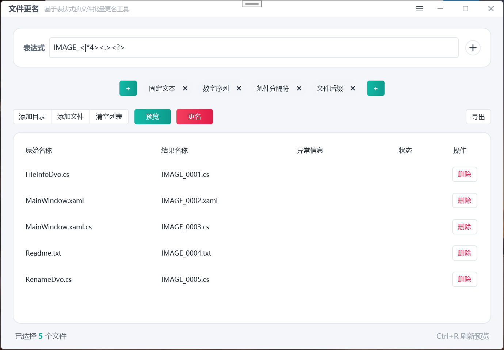
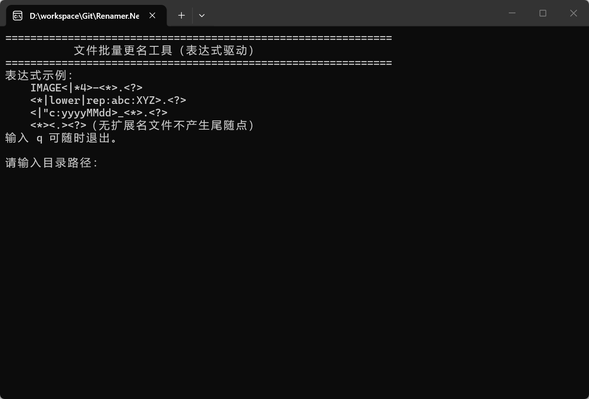

# Renamer.Net

基于表达式驱动的 .NET 文件批量更名工具。把命名规则写成一行模板表达式，**编译 → 预览 → 提交**三段式执行，预览阶段绝不触碰磁盘。

## 功能特性

- **一行表达式描述命名规则**：字面量与 `<...>` 表达式交替组合，覆盖名称/扩展名引用、大小写转换、管道函数（upper/lower/rep/cut/ins/del）、数字与字母序列、文件时间戳、条件分隔符等七类模式。
- **三段式安全流程**：`Compile` 编译校验（错误带精确字符位置）→ `Preview` 只读预览（检测重名、占用、非法字符等冲突，绝不触碰磁盘）→ `Commit` 提交改名。
- **冲突策略**：`Fail` 遇冲突即中止；`AutoSuffix` 自动追加 ` (n)` 后缀消解。
- **两阶段提交**：循环/链式改名（如 `a→b` 且 `b→a`）通过同目录临时文件名两阶段安全落地，失败自动回滚。
- **双前端**：`Renamer.Cmd` 命令行版（交互 + 参数两种模式，内置帮助）；`Renamer.Wpf` 图形界面版（HandyControl，可视化编辑器 + 预览表格）。
- **可嵌入**：核心库 `Renamer.Net` 面向 `netstandard2.0`，可在任意 .NET 程序中调用。

## 技术栈与项目结构

| 项目 | 目标框架 | 说明 |
| --- | --- | --- |
| `Renamer.Net` | netstandard2.0 | 核心库：模板解析、模式求值、预览、提交 |
| `Renamer.Cmd` | net10.0 | 命令行前端 |
| `Renamer.Wpf` | net10.0-windows | WPF 图形前端（HandyControl 3.5.1 + WindowsAPICodePack 1.1.5） |

```
Renamer.Net/            核心库
  TemplateParser.cs     模板解析器
  Renamer.cs            编译/预览/提交 API
  RenamePlan.cs         预览结果与冲突检测
  Patterns/             七类模式实现
  Readme.txt            表达式规则完整文档（含 EBNF 文法）
Renamer.Cmd/            命令行前端
  Program.cs            交互与参数解析
  HelpText.cs           表达式使用说明输出
Renamer.Wpf/            WPF 图形前端
  MainWindow.xaml       主窗口
  Editor/               各模式可视化编辑器
```

## 构建与运行

需要 [.NET 10 SDK](https://dotnet.microsoft.com/download)。

```powershell
# 构建解决方案
dotnet build Renamer.Net.slnx

# 运行命令行版（交互模式）
dotnet run --project Renamer.Cmd

# 运行图形界面版
dotnet run --project Renamer.Wpf
```

## 命令行使用

```powershell
# 查看表达式使用说明
Renamer.Cmd help

# 参数直调：目录 表达式 [冲突策略 fail|auto]
Renamer.Cmd "D:\Photos" "IMAGE_<|*4><.><?>" auto

# 交互模式（依次输入目录、选择模板/输入表达式、选择冲突策略）
Renamer.Cmd
```

交互输入 `help` / `?` 可随时查看表达式使用说明，输入 `q` 退出。

## 图形界面



交互流程：**输入目录 → 选择更名模板 → 手动输入表达式 → 编译 → 预览 → 确认提交**。

- 快捷标签芯片可一键插入常用表达式片段；
- 每类模式均有独立可视化编辑器；
- 预览表格实时显示原始名称、结果名称、异常信息与状态，支持行内删除；
- `Ctrl+R` 刷新预览。



## 表达式语法速查

模板由**字面量文本**与**表达式**交替组成，表达式用尖括号 `<...>` 定界，不允许嵌套。模板特殊字符（`< > * ? " : | \ /`）均为 Windows 文件名非法字符，词法扫描无歧义。

### 名称 / 扩展名

| 表达式 | 说明 |
| --- | --- |
| `<*>` `<?>` | 原文件名 / 原扩展名（不含点） |
| `<*|\>` `<*|/>` | 文件名转大写 / 小写 |
| `<*\|函数1\|函数2\|...>` | 管道串联：`upper` `lower` `rep:查找:替换` `cut:L:i:j` `ins:L:i:文本` `del:L:i:长度` |

```text
<*|lower|rep:abc:XYZ|cut:L:1:4>   Abcabcdef.jpg -> XYZX.jpg
```

### 序列与时间

| 表达式 | 说明 |
| --- | --- |
| `<|*4>` `<|*4:10:2>` | 数字序列（位宽、起始、步长） |
| `<|?/3>` `<|?\3>` `<|?01:2>` | 字母 / 自定义字符集序列（双射进制） |
| `<|">` `<|"c:yyyyMMdd>` `<|":yyyy-MM-dd>` | 时间信息（当前 / 创建 / 修改 / 访问） |
| `<.>` | 条件分隔符：有扩展名输出点，否则空串 |

完整规则与 EBNF 文法见 [Renamer.Net/Readme.txt](Renamer.Net/Readme.txt)。

## 作为库嵌入

```csharp
using Com.Scm.Renamer;

// 1. 编译
Renamer renamer = Renamer.Compile("IMAGE_<|*4><.><?>");

// 2. 预览（只读，不触碰磁盘）
RenamePlan plan = renamer.Preview(files, ConflictMode.AutoSuffix);
if (!plan.CanCommit) { /* 处理 plan.Issues */ }

// 3. 提交
RenamePlan result = renamer.Commit(files, ConflictMode.AutoSuffix);
```

- `Compile` 失败抛出 `TemplateParseException`，含 `Position`（出错字符的 0 基位置）。
- `RenamePlan.Items` 中每个 `FileItem.Status` 为四态：`Ok` / `NoChange` / `Resolved` / `Error`，错误说明在 `IssueMessage`。

## 已知限制与后续路线

- 暂不支持正则替换；`rep` 管道的查找文本不能含 `|`（可用旧式文字替换 `<*查找|替换>` 临时替代）。
- 流水序号按传入列表顺序发号，尚不支持按名称/时间排序发号、按目录复位。
- 交换式改名链已通过临时文件名两阶段方案解决，批次整体非原子操作。

## 许可证

见 [LICENSE](LICENSE)。
